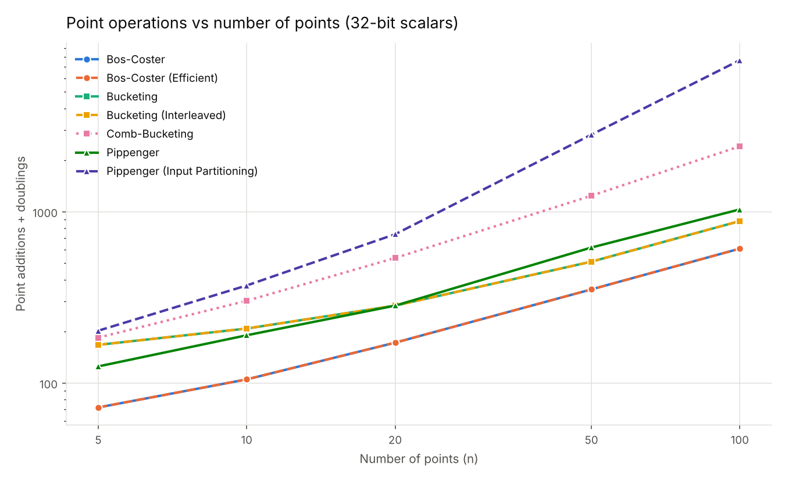
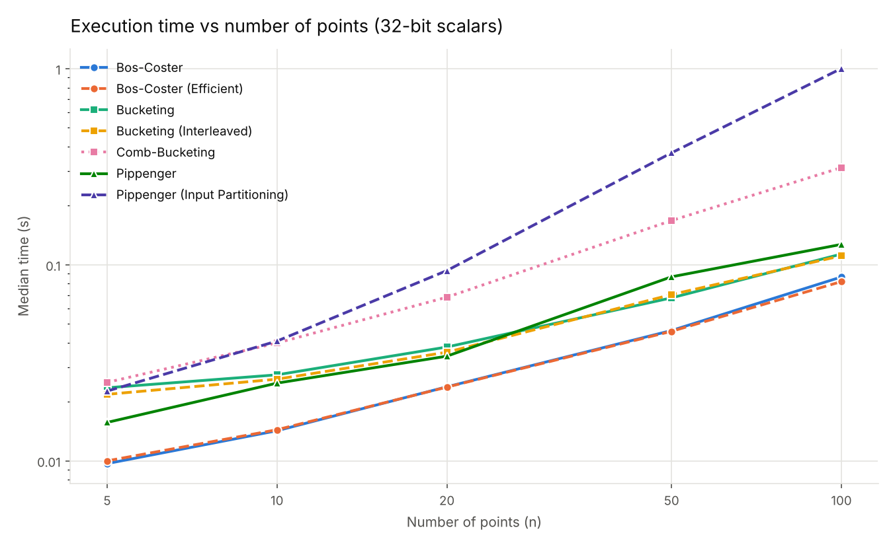

# Optimising Multi-Scalar Multiplication

**Bos-Coster vs Bucketing vs Pippenger: implemented, tested and benchmarked in Python**

BSc (Hons) Computer Science dissertation, University of Surrey, 2025. Supervised by Dr Robert Granger.

[](https://github.com/Yousefscode/Optimising-Multi-Scalar-Multiplication/actions/workflows/tests.yml)


---

Multi-scalar multiplication (MSM) computes

$$a_1P_1 + a_2P_2 + \dots + a_nP_n$$

for elliptic-curve points $P_i$ and integer scalars $a_i$. It is the main cost in batch signature verification, key-exchange protocols and zero-knowledge proof systems, so the algorithm you pick matters.

This project implements seven variants of the three classic MSM algorithms on **secp256k1**. Every variant is checked against the naive method. They are compared on exact point-operation counts, wall-clock time and peak memory, across different numbers of points and scalar bit lengths.

| Family | Variants | Idea |
|---|---|---|
| **Bos-Coster** | basic, efficient (ordered insertion) | Repeatedly rewrite the two largest terms: $a_1P_1 + a_2P_2 = (a_1-a_2)P_1 + a_2(P_1+P_2)$ |
| **Bucketing** | basic, interleaved, comb | Split scalars into $w$-bit windows, drop points into buckets by window value, combine buckets with the running-sum trick |
| **Pippenger** | standard, input partitioning | Bucket method with window width $c \approx \log_2 n$, chosen from the input size |

## Results

<p align="center">
  
  
</p>

Point operations (additions + doublings) for selected cases. Lower is better; the lowest in each row is in **bold**.

| Points × bits | Bos-Coster | Bucketing (w=4) | Comb-Bucketing | Pippenger | Pippenger (partitioned) |
|---|---:|---:|---:|---:|---:|
| 5 × 32 | **72** | 167 | 184 | 125 | 202 |
| 20 × 32 | **172** | 283 | 537 | 283 | 739 |
| 100 × 32 | **609** | 882 | 2,410 | 1,032 | 7,669 |
| 20 × 128 | **685** | 1,167 | 2,168 | 1,167 | 3,079 |
| 100 × 256 | **4,640** | 7,146 | 19,370 | 8,440 | 66,427 |

Full results for all 12 cases are in [`results/benchmark_results.csv`](results/benchmark_results.csv), with more figures in [`results/figures/`](results/figures).

**Findings**

- **Bos-Coster used the fewest point operations and was fastest in every case tested.** At 100 points with 256-bit scalars it needed about 35% fewer operations than bucketing and 45% fewer than Pippenger. A follow-up count at 1,000 points with 256-bit scalars gave the same ordering: Bos-Coster 31k, Pippenger 52k, bucketing 61k.
- **Pippenger's asymptotic advantage does not appear at these sizes.** With $c = \log_2 n$ its window is wider than ideal for $n \le 1000$: at 100 points, $c = 7$ needs $2^7$ buckets per window. Within the dissertation's grid (up to 100 points), fixed 4-bit bucketing matched or beat it from 20 points up. Pippenger pays off at the very large input sizes used in zero-knowledge provers.
- **Comb-bucketing only pays off with precomputation.** Each point needs shifted copies $2^{jL}P$. When those are computed on every call, as here, they dominate the cost. In a fixed-base setting they would be precomputed once.
- **Input partitioning hurts at this scale.** Each chunk of about $\log_2 n$ points is solved with a $\log_2 n$-bit window, so most buckets stay nearly empty and their fixed cost is paid many times over.
- **Memory:** bucketing and Pippenger (but not comb-bucketing) used the least peak memory at 50 points and above. Bos-Coster's working list grows with $n$, and comb-bucketing stores its shifted points.

> ### Post-submission correction
> While turning the dissertation notebook into this package, I added a test that checks every algorithm against the naive result. It showed that five of the seven submitted implementations (all the bucketing and Pippenger variants) returned the wrong point. Each bucket was added to the result **once**, instead of being weighted by its bucket index. As a result, the operation counts and timings in the dissertation are too low for those algorithms, and its conclusion that Pippenger was the most efficient does not hold once they are fixed.
>
> The code in [`msm/`](msm) is corrected and covered by [`tests/`](tests). The results above come from it. The original notebook is kept unchanged in [`notebooks/`](notebooks) as the record of what was submitted.

## Repository layout

```
├── msm/                         # the algorithms as an importable package
│   ├── curve_utils.py           # curve helpers, naive MSM, exact operation counter
│   ├── bos_coster.py            # Bos-Coster (basic + efficient)
│   ├── bucketing.py             # bucketing (basic, interleaved, comb)
│   ├── pippenger.py             # Pippenger (standard + input partitioning)
│   ├── benchmark.py             # benchmark runner (python -m msm.benchmark)
│   └── plots.py                 # figures
├── tests/test_correctness.py    # every algorithm vs the naive result
├── results/                     # benchmark CSV + figures
├── notebooks/dissertation_notebook.ipynb   # original notebook, as submitted
└── docs/dissertation.pdf        # full dissertation
```

## Running it

```bash
git clone https://github.com/Yousefscode/Optimising-Multi-Scalar-Multiplication.git
cd Optimising-Multi-Scalar-Multiplication
pip install -r requirements.txt

python -m pytest                    # correctness tests (about 10 s)
python -m msm.benchmark --quick     # small benchmark (a few seconds)
python -m msm.benchmark             # full benchmark + figures (about 4 min)
```

Using the library directly:

```python
import msm

curve = msm.get_curve("secp256k1")
scalars, points = msm.generate_test_case(curve, n=50, scalar_bits=128)

with msm.count_operations() as ops:
    result = msm.bos_coster_efficient(scalars, points)

assert result == msm.naive_msm(scalars, points)
print(ops)   # {'additions': ..., 'doublings': ...}
```

## Method notes

- **Curve:** secp256k1 via [ECPy](https://github.com/cslashm/ECPy), which is pure Python. Absolute timings are therefore slow; the comparison between algorithms is what matters.
- **Operation counting:** point additions and doublings are counted exactly by wrapping ECPy's `Point.__add__`. Adding a point to itself counts as a doubling. A direct scalar multiplication (used in Bos-Coster's last step and the naive reference) is charged as double-and-add.
- **Timing:** median of 3 runs with `time.perf_counter()`. Every input is seeded, so the results can be reproduced.
- **Memory:** peak Python allocation during one run, measured with `tracemalloc`.

## Dissertation

The full write-up, including the literature review, the theory behind each algorithm and the analysis, is in [`docs/dissertation.pdf`](docs/dissertation.pdf).

## Author

**Yousef Abdelghani** · [LinkedIn](https://www.linkedin.com/in/yousef-abdelghani-6a3ba9213) · [GitHub](https://github.com/Yousefscode)

Code is released under the [MIT License](LICENSE). The dissertation PDF remains © Yousef Abdelghani.
